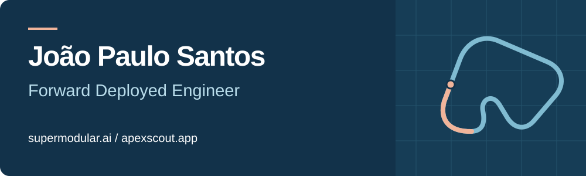

### From a customer problem to software in production.

I'm João, a **Forward Deployed Engineer at [Supermodular.ai](https://supermodular.ai)** and the builder behind **[Apex Scout](https://apexscout.app)**. I work across the whole product: understanding the workflow, designing the architecture, writing the code, and keeping it running.

Based in Leiria, Portugal. More than seven years building with Laravel.

## Where my focus goes

**Supermodular.ai** 
Forward deployed engineering, with a focus on AI and software delivery.

**Apex Scout** 
A platform for track-day discovery, preparation, garage management, and community. Built from my own experience in the paddock, with a growing focus on tools for racing teams.

## Things I've shipped

At **Voltimum**, I built multi-agent assistants for warehouse queries and internal support, with streaming responses, evaluations, and cost controls. At **Patchstack**, I led the Vulnerability Database API rewrite and migrated the system incrementally while the existing API stayed live.

Through **[FunnySoft](https://funnysoft.pt)**, I've taken client applications and SaaS products from the initial problem through deployment and production support.

## Open source

**[scout-postgres](https://github.com/jonaspauleta/scout-postgres)** 
PostgreSQL full-text and trigram search for Laravel Scout. One less service to run. [Reproducible benchmark](https://github.com/jonaspauleta/scout-postgres-benchmark).

**[laravel-ai-moonshot](https://github.com/jonaspauleta/laravel-ai-moonshot)** 
Moonshot AI for the Laravel AI SDK, with streaming, tool calling, and reasoning support.

**[laravel-base-kit](https://github.com/jonaspauleta/laravel-base-kit)** 
A Claude Code plugin for scaffolding Laravel, Inertia, and React projects.

## Off the clock. On the limit.

**Mini JCW R56. Built, tuned, and driven on track.**

I spend my time in the garage and the paddock, chasing a better setup and a faster lap. Apex Scout started with that same obsession.

---

[Supermodular.ai](https://supermodular.ai) · [Apex Scout](https://apexscout.app) · [LinkedIn](https://www.linkedin.com/in/joao-p-c-santos/) · [GitHub](https://github.com/jonaspauleta) · [GitLab](https://gitlab.com/jonaspauleta)
